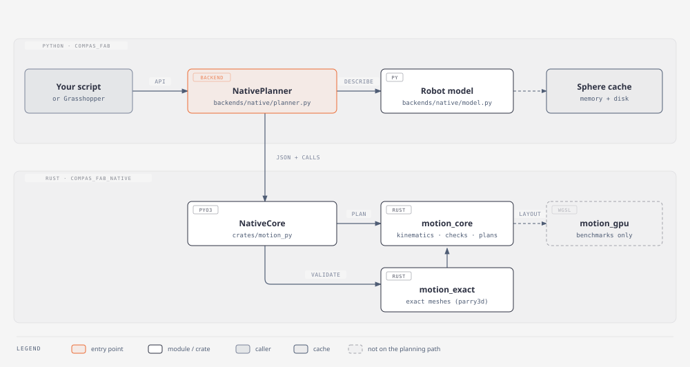
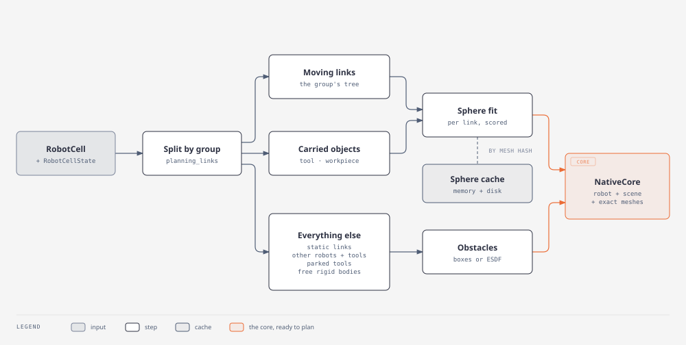
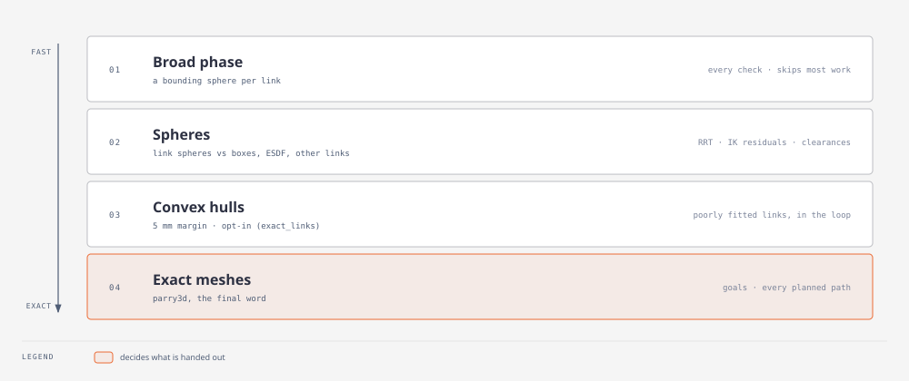
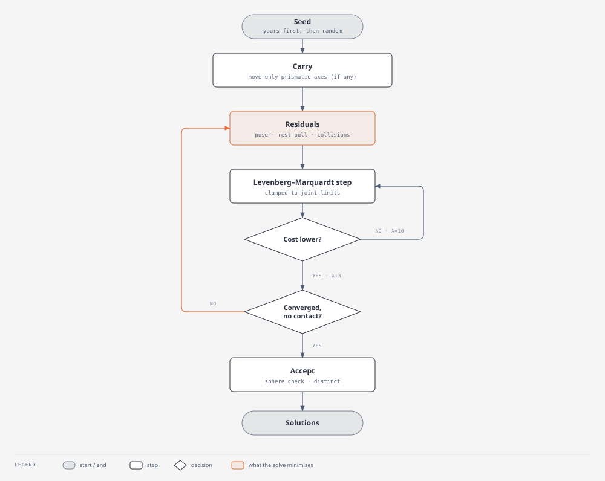
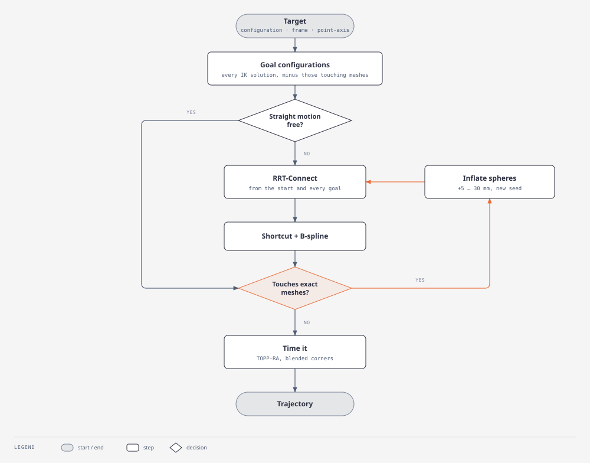
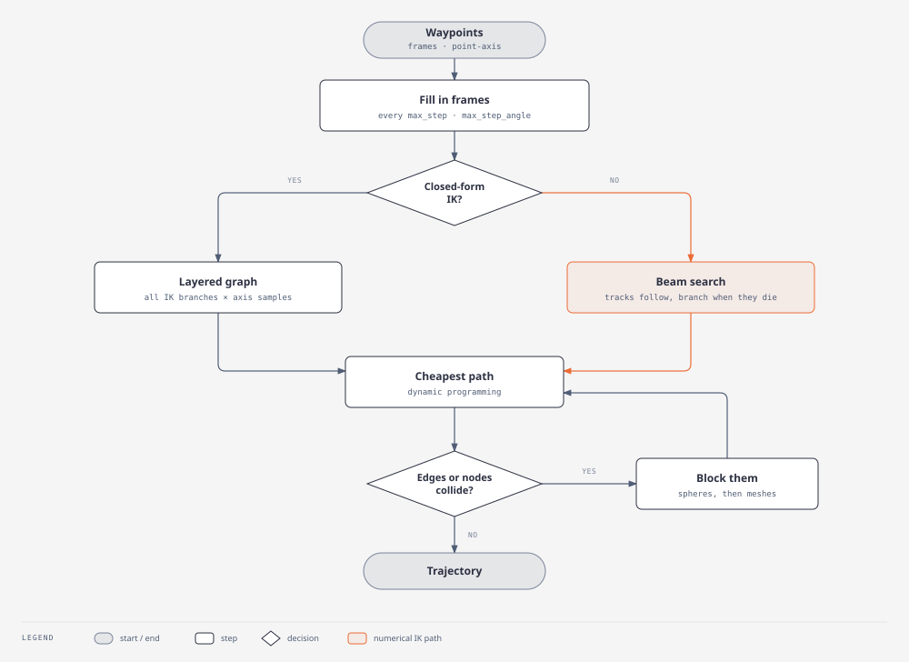

# How the native backend works

This page explains what the native backend does internally: which parts exist, what
happens when you call it, and why it is built that way. It is written for people who
maintain or extend it. For using it, see [Native (experimental)](index.md).

The diagrams are generated by `docs/diagrams/build.py`. Click one to open
it full size.

## The big picture

The backend has two halves.

**Python** (`src/compas_fab_native/`) translates between compas_fab and the
core:

- `planner.py` holds `NativePlanner`, which implements the compas_fab backend features
  (`SetRobotCell`, `InverseKinematics`, `PlanMotion`, …). It converts targets, waypoints and
  target modes (robot, tool, workpiece) into frames of the robot's end-effector link in
  robot coordinates, calls the core, and turns its results into compas_fab objects
  (`Configuration`, `JointTrajectory`).
- `model.py` describes a `RobotCell` in the form the core needs: a kinematic tree, collision
  spheres, obstacle boxes and meshes. This is where the geometry work happens (sphere
  fitting, bounding boxes, which links move and which do not).

**Rust** (`crates/`) does the numeric work:

- `motion_py` is the Python extension (`compas_fab_native.NativeCore`). It holds one robot
  and its scene, and releases the GIL while it works. Robots and scenes cross the boundary
  as JSON; frames as flat lists of 12 numbers (a 3×4 matrix, row-major).
- `motion_core` is the planner proper: forward kinematics, the collision checkers, IK, the
  Cartesian and free-space planners, and time parameterization.
- `motion_exact` checks configurations on the exact collision meshes (with parry3d).
- `motion_gpu` runs the same collision queries on the GPU. Only the benchmarks use it.

A call such as `plan_motion` goes: `NativePlanner` → `NativeCore.plan_motion` →
`motion_core::freespace::plan`, with `motion_exact` validating the result.

## Setting up a cell

`set_robot_cell(cell, state, options={"group": ...})` builds the robot description once.
`set_robot_cell_state` then updates the core whenever the state changes.

1. **Split by planning group** (`model.planning_links`). The core plans one group, such as
   the UR5's `manipulator` or the RFL's `robot11_eaXYZ` (a gantry and an arm, 9 joints).
   Links that the group's joints move form the core's kinematic tree. Every other link
   becomes a static obstacle posed at the state's configuration: in the RFL that is the
   other bridge, its robots, the rails and the hall. The core takes at most 32 links, and
   this split is what keeps large cells within that limit. A single robot is described
   whole, exactly as before the split existed.
2. **Carried objects** (`model.carried_objects`): the tool attached to the group, rigid
   bodies attached to that tool (a workpiece in the gripper), and rigid bodies attached to
   links the group moves. They get spheres on the link that carries them, and collisions
   with their touch links are disabled.
3. **Everything else** (`model.static_obstacles`, plus free rigid bodies) becomes obstacles:
   - static links;
   - tools on other groups and what they hold;
   - bodies attached to links the group cannot move;
   - parked tools.

   Obstacles reach the core as oriented boxes (`obstacle_boxes`, the smallest of a few
   candidate boxes), or, with `NativePlanner(obstacles="esdf")`, as a signed distance field
   built from their meshes, which keeps holes and concave shapes open.
4. **Sphere fit** (`model.fit_sphere_sets`, which runs in the core: `motion_exact::spheres`).
   Each link gets two sets:
   - *self-collision spheres*, inscribed in the mesh (spheres around neighbouring links
     would overlap permanently);
   - *obstacle spheres*, the same spheres grown by 2 cm.

   Fits are scored by how far the surface reaches outside the spheres (`miss`). Links
   without a closed mesh get spheres that enclose clusters of surface points instead. They're cached in memory and on disk, keyed by the mesh and the options,
   so setting up the same cell again takes milliseconds (`cached_sphere_sets`).
5. **Exact meshes**: every link and obstacle mesh also goes to `motion_exact`.

When the state changes, three things can happen, keyed in `set_robot_cell_state`:

- **Attachments changed** (`_attachment_key`): the robot's own spheres change, so the core
  is rebuilt.
- **Obstacles changed** (`scene_key`, including touch links): only the scene is replaced
  (`NativeCore.set_scene`).
- **Joints outside the group moved** (a gripper's fingers, mimic joints): those values are
  folded into the joint origins (`set_passive_joints`).

When the core is built it also samples 1,000 random configurations. Link pairs whose
spheres overlap in 95% of them are treated like SRDF-disabled pairs, as MoveIt does for
pairs that are "always in collision". The same is done for spheres that always touch an
obstacle box, such as a base standing on the floor.

## The collision model

Planning needs millions of collision checks, and exactness is only needed at the end. So
the backend checks in layers:

1. **Broad phase**: each link has a bounding sphere around its spheres. A link whose
   bounding sphere is clear of everything is skipped as a whole.
2. **Spheres**: link spheres against obstacle boxes, the ESDF and other links' spheres.
   There are two implementations:
   - `motion_core::check::Checker` answers yes or no. RRT, motion checks and timing use it.
     It runs 4 configurations at once (8 on x86) in SIMD and stops at the first contact,
     following VAMP's design.
   - `motion_core::cpu::collision_min_lanes` returns clearances, the smallest distance in
     metres. IK, the Cartesian planners and `check_collision` use it.
3. **Convex hulls** (opt-in): `NativePlanner(exact_links="auto")` also checks the links that
   spheres represent poorly on every configuration the spheres pass, as convex hulls with
   a 5 mm margin (`ExactChecker::check_focus`). `planner.poorly_fitted_links` lists those
   links: gantry carriages, tall bases.
4. **Exact meshes** (`ExactChecker::check`): parry3d mesh-against-mesh tests. They decide
   what is handed out. Goals of `plan_motion` that touch the meshes are dropped, and every
   planned path is checked along its length. A path that fails is planned again.

Sphere accuracy, measured with `fit_miss` at the 95th percentile:

| Robot | Miss |
|---|---|
| UR5, Panda | 1–2 cm |
| ABB IRB 4600 | 6.5–9 cm |
| RFL carriages | 0.4–0.6 m |
| RFL bridge | up to 1.4 m |

The exact check makes the result correct either way, but the more the spheres miss, the
more plans get rejected and redone. Boxes as robot-side primitives are the open fix
(see `SPIKE.md`).

**Touch links** work as in compas_fab: an obstacle or carried object lists the links that
may touch it. Each check skips those pairs: spheres, hulls and meshes alike.

## Inverse kinematics

The core picks the IK per robot:

- **Closed form** (`motion_core::ik`): a port of ROS-Industrial's `ur_kinematics` for UR
  arms, and a solver derived from the model for 6-axis arms with a spherical wrist (ABB,
  Stäubli, KUKA-like). It returns every solution within the joint limits.
- **Numerical** (`motion_core::numik`), for every other robot: 7-axis arms, robots on
  external axes. `options={"ik": "numeric"}` uses it for any robot.

Numerical IK solves one weighted least-squares problem per seed, after PyRoki's
formulation:

- **Pose**: the TCP position and its rotation. For a point-axis target, only the direction
  of the tool axis counts, so the rotation about it is free.
- **Rest pull**: a weak pull towards the seed's posture. It only steers the joints a
  redundant arm can move without moving the TCP, and it is dropped near the target so it
  never bends the result.
- **Collisions**: obstacle spheres within 1 cm of an obstacle, and self-collision sphere
  pairs within 1 cm of each other. Near the target the margin drops to zero, so only real
  contacts count.

Jacobians are written out: the geometric Jacobian of the chain, and the sphere distance
gradients the checker already has. Joint limits are kept by clamping every step.

Robots with prismatic joints (gantries, rails) first go through a **carry** stage. It moves
only those joints, so the TCP reaches the target with the seed's arm posture. Without it, a
random seed on a 37 m rail would leave the arm stretching for a target metres away.

Seeds are the caller's first (for example the current configuration), then random ones,
solved in parallel. Solutions are kept if the pose converged, nothing touches, the checker
accepts them, and they differ from the ones already found.

## Free motion: `plan_motion`

1. **Goals.**
   - A configuration target is its own goal.
   - A frame target becomes every IK solution.
   - A point-axis target becomes the solutions over rotations about the axis: sampled for
     the closed form, continuous for numerical IK.

   Goals that touch the exact meshes are dropped first, because every path to them would
   fail the final check.
2. **Straight motion.** If the joint-space line from the start to a goal is free, that's
   the path.
3. **RRT-Connect** (`motion_core::freespace`) grows trees from the start and from every
   goal at once, with VAMP's dynamic domain and tree balancing. The path is then shortened
   and smoothed with B-splines.
4. **Exact check** along the path, every 0.02 rad. If the path touches, the planner
   re-plans with spheres inflated by 5, 10, 20 and 30 mm. Inflating keeps it from finding
   the same grazing path again; a new seed alone would not.
5. **Timing** (`motion_core::timing`). Corners are rounded off within `blend_tolerance` where
   the rounded corner is free. Speeds come from TOPP-RA: the fastest motion within the
   joint velocity and acceleration limits, starting and ending at rest.

## Cartesian paths: `plan_cartesian_motion`

1. **Fill in frames.** Frames are added between waypoints every `max_step` (1 cm) and
   `max_step_angle` (0.1 rad), so the tool moves in straight lines. `max_step: 0` keeps
   only the given waypoints.
2. **Closed-form robots** (`cartesian::plan_cartesian_with`). Every frame, rotated about
   the tool axis `free_axis_samples` times, gets all its IK solutions: one layer per frame.
   All solutions are collision-checked in one batch, and dynamic programming finds the path
   through the layers with the least joint motion. No joint may move more than
   `max_joint_step` between frames.
3. **Other robots** (`cartesian::plan_cartesian_tracked`), a beam search:
   - Each frame keeps up to `tracks` (8) configurations, each solved from one of the
     previous frame's, using it as both seed and rest posture so the joints move as
     little as possible.
   - When fewer than a quarter survive (collisions, joint limits, a lost target), the
     search branches from perturbed postures.
   - The path is then the cheapest through the layers, as in step 2.
4. **Lazy checks** in both planners. The motion along the chosen path is checked: on the
   spheres, then on the exact meshes. Failing edges and nodes are blocked and the search
   runs again, until a path passes or none is left.

## Where things live

| Concern | Python | Rust |
|---|---|---|
| Robot and scene description, sphere fitting, cache | `model.py` | `motion_core::model` (loading) |
| Backend API, targets, target modes | `planner.py` | `motion_py` (bindings) |
| Forward kinematics | | `motion_core::reference` (f64), `check` and `cpu` (SIMD) |
| Collision checks | | `motion_core::check` (yes/no), `motion_core::cpu` (clearances), `motion_core::esdf` |
| Exact checks, convex hulls | | `motion_exact` |
| IK | | `motion_core::ik` (closed form), `motion_core::numik` (numerical) |
| Cartesian planning | | `motion_core::cartesian` |
| Free-space planning | | `motion_core::freespace` |
| Time parameterization | | `motion_core::timing` |

Design notes, measurements and open issues are in
[`SPIKE.md`](../SPIKE.md).
Credits for ported code and the algorithms followed are in `NOTICE`.
